*I am the sun; my languages are the planets and my projects their moons.*

**Moons:** [Orion](https://github.com/dipu01-code/Orion) · [VisionPilot](https://github.com/dipu01-code/VisionPilot) · [BuildX](https://github.com/dipu01-code/BuildX) · [TerPlayer](https://github.com/dipu01-code/TerPlayer)

### 🪐 Orbit log

<b>🧭 About me, tech stack and projects</b>

### AI & ML Engineer | Software Developer | Open-Source Enthusiast

I'm a B.Tech Computer Science student specializing in **Artificial Intelligence and Machine Learning** at Newton School of Technology, ADY Patil University, Pune, India.

I'm passionate about building intelligent systems, developing practical software solutions, exploring open-source technologies, and understanding how things work under the hood.

I enjoy working at the intersection of **AI/ML, software engineering, computer vision, automation, and robotics**. My approach to engineering is to learn by building, experiment with new technologies, and turn ideas into functional products.

## 🚀 About Me

- 🎓 Pursuing B.Tech in Computer Science (AI & ML).
- 🤖 Interested in Artificial Intelligence, Machine Learning, and intelligent agents.
- 💻 Building software projects using Python, JavaScript, and modern development tools.
- 👁️ Exploring Computer Vision, OpenCV, and vision-based AI systems.
- 🦾 Interested in robotics, autonomous systems, and ROS 2.
- 🌐 Exploring backend engineering, APIs, databases, and full-stack development.
- 🔓 Interested in contributing to open-source projects and collaborating with developers.
- 🧠 Believe in continuous learning, experimentation, and building things from scratch.

**My philosophy:** Don't just use technology. Understand it, experiment with it, and build something meaningful with it.

---

## 🛠️ Tech Stack & Tools

### Programming Languages
- Python
- JavaScript
- C++
- SQL

### AI / ML & Computer Vision
- Machine Learning
- Artificial Intelligence
- OpenCV
- Computer Vision
- Retrieval-Augmented Generation (RAG)
- AI Agents and Automation

### Backend & Web Development
- Node.js
- Express.js
- FastAPI
- React
- REST APIs
- Socket.IO

### Databases
- PostgreSQL
- MongoDB
- SQLite
- Supabase

### Developer Tools & Infrastructure
- Git & GitHub
- Docker
- Linux
- macOS
- AWS
- VS Code
- Postman

### Exploring
- ROS 2
- Autonomous Robotics
- Deep Learning
- LLM Architecture
- Agentic AI Systems

---

## 🔥 Featured Projects

### 1. ORION — Personal AI Assistant
An intelligent personal assistant inspired by futuristic AI systems.

- Exploring a hybrid architecture combining locally developed models with interchangeable model interfaces.
- Building a modular tool execution system.
- Experimenting with voice interaction and intelligent automation.
- Focused on creating an extensible AI assistant.

**Technologies:** Python, Node.js, React, Electron, Tailwind CSS.

### 2. VisionPilot — Agentic Computer Vision
An AI-powered computer vision project focused on making visual systems more intelligent and actionable.

- Exploring OpenCV-based image and video analysis.
- Building an agentic workflow for interpreting visual information.
- Working on decision-making and auditable action execution.
- Exploring cloud deployment using AWS and Docker.

**Technologies:** Python, OpenCV, Streamlit, Docker, AWS.

### 3. Alpha Intelligence Engine
A research-oriented RAG platform for quantitative finance knowledge.

- Developing a document ingestion and retrieval pipeline.
- Exploring knowledge extraction and semantic search.
- Building APIs for accessing research insights.
- Experimenting with structured financial knowledge.

**Technologies:** Python, FastAPI, PostgreSQL, RAG.

### 4. TerPlayer
A terminal-based music player built for the command line.

- Building an interactive terminal user experience.
- Exploring Node.js CLI development.
- Experimenting with themes and terminal interfaces.

**Technologies:** Node.js, JavaScript, React Ink.

### 5. ChargeMate
An idea focused on peer-to-peer EV charging infrastructure.

- Exploring a platform connecting EV owners with home charging hosts.
- Focused on accessible charging infrastructure and host monetization.
- Exploring location-based services and modern application architecture.

**Technologies:** React, Supabase, and modern web technologies.

---

## 🌱 Currently Learning

- Advanced Data Structures and Algorithms.
- Machine Learning and Deep Learning.
- Backend architecture and scalable systems.
- AI agents, LLMs, and RAG architectures.
- Computer Vision and OpenCV.
- Robotics and ROS 2.
- Open-source development and collaborative engineering.

---

## 🎯 My Long-Term Goals

- Build production-ready AI/ML products.
- Develop intelligent agents and autonomous systems.
- Contribute consistently to impactful open-source projects.
- Explore robotics, drones, and humanoid systems.
- Develop a strong foundation in systems engineering.
- Become an engineer capable of researching, designing, and building complete intelligent systems.

---

## 🤝 Open Source & Collaboration

I'm interested in collaborating with developers, researchers, and open-source communities.

I'm particularly interested in projects involving:

- Artificial Intelligence and Machine Learning.
- Developer tools and automation.
- Computer Vision.
- Robotics and autonomous systems.
- Backend and infrastructure engineering.

If you're building something interesting in these areas, I'd be happy to explore opportunities to collaborate.

---

[GitHub](https://github.com/dipu01-code)

*Solar System · planets are languages, moons are repos, comets are recent pushes*

